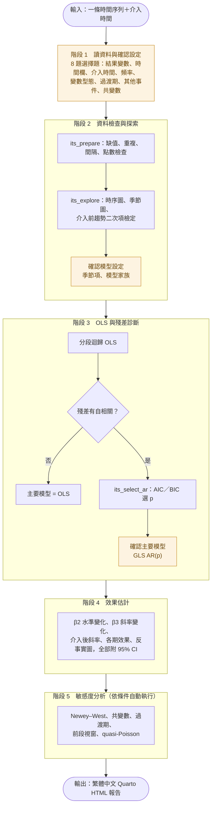

# 介入分析（中斷時間序列 ITS）Skill 使用說明

<!-- 本文件為使用說明的唯一原始檔（寫法以 GitHub 顯示為準）。修改後執行 `tools/build_readme_html.sh` 重新產生 README.html，並一起 commit。 -->

## 第一章　動機

政策、法規、新療程、新建設上路後，最常被問的問題是：

- 事件發生後，結果有沒有**立刻跳動**（水準改變）？
- 之後的**趨勢**有沒有改變（斜率改變）？
- 如果沒有這個事件，現在應該是多少（反事實）？

中斷時間序列（interrupted time series, ITS）以分段迴歸回答這些問題，是沒有隨機分派時最常用的準實驗設計之一。但實務上有幾個地方很容易出錯：時間序列殘差常有自相關，直接用 OLS 會低估標準誤；季節性沒處理會混進效果；介入前趨勢本身不是直線時，反事實就不可信。

本 skill 讓 Claude 以固定、可重現的流程帶使用者完成整個分析，設計上依循三項原則：

1. **數字只來自審查過的 R 函數。** 所有統計量都由 `scripts/its.R` 計算，Claude 不心算、不臨時改寫程式。
2. **關鍵決策由使用者做。** 介入時間、模型設定、自相關結構等，在確認點停下來用選擇題詢問，推薦選項附上理由。
3. **結論與限制並陳。** 依條件自動做敏感度分析，並依 ITS 的兩個核心假設（趨勢延續、沒有同時事件）解釋結果。

> [!NOTE]
>
> ### 適用範圍
>
> 一條間隔相等的序列（年、季、月、週、日）、一個已知介入時間點（可設過渡期）、連續或計數的結果變數。
> 介入時間未知（找斷點）、多個介入點或有控制序列、多單位面板資料、預測未來，都不在範圍內，skill 會說明理由並建議其他方法。

## 第二章　分析流程

流程共五個階段。黃色節點為使用者確認的環節，菱形為依資料自動分流之處。



### 核心模型

$$
Y_t = \beta_0 + \beta_1 T_t + \beta_2 X_t + \beta_3 (T_t - T_0)X_t + \text{季節項} + \varepsilon_t
$$

$X_t$ 為介入指標（介入前 0、介入後 1），$T_0$ 為介入開始的時間點。介入後第 $k$ 期的效果為 $\beta_2 + \beta_3 k$；反事實線為介入前趨勢的延伸。詳見 [references/methods.md](references/methods.md)。

| 係數 | 意義 |
|---|---|
| β1 | 介入前斜率 |
| β2 | 介入當期的**水準變化** |
| β3 | 介入後的**斜率變化**（介入後斜率 = β1 + β3） |

### 各階段的自動判斷規則

| 情況 | skill 的做法 |
|---|---|
| 資料有缺值、重複、間隔不等、介入點不在範圍內 | 停止並說明原因，不自動插補或刪資料 |
| 任一段少於 12 點 | 警告檢定力有限，可以繼續 |
| OLS 殘差有自相關 | 改用 GLS AR(p)，p 以 AIC 建議，由使用者確認 |
| GLS 標準化殘差仍有自相關 | 照實說明並建議 ARIMA（範圍外） |
| 介入前趨勢二次項 p < .10 | 提醒反事實可能不可信，自動做「前段視窗」敏感度分析 |
| 結果是計數資料 | 自動做 quasi-Poisson 敏感度分析（率比） |
| 使用者選了過渡期或共變數 | 自動做對應的敏感度分析 |

### 寫作規則

- p ≥ .05 寫「沒有足夠證據顯示…」，不寫「沒有效果」；p < .05 也不寫「證明介入造成…」。
- 主要模型是 GLS 時，OLS 與 Newey–West 只當對照，不拿來說「結論穩健」（模擬中型一錯誤約 20–30%）。

## 第三章　安裝與使用

### 需求

- R（已在 R 4.4.3 測試），套件：`nlme`、`sandwich`、`lmtest`、`ggplot2`
- Quarto（產生報告用；RStudio 內建的 Quarto 也可以）

```r
install.packages(c("nlme", "sandwich", "lmtest", "ggplot2"))
```

### 安裝 skill

- **Claude Code**：把 `its-intervention.zip` 解壓縮到 `~/.claude/skills/`，得到 `~/.claude/skills/its-intervention/SKILL.md`。
- **claude.ai**：在 Settings → Capabilities → Skills 上傳 `its-intervention.zip`。

### 使用

附上一份時間序列資料（CSV），用自然語言提出問題即可，例如：

> 這是英國每月駕駛死亡人數，1983 年 1 月底開始強制繫安全帶，請幫我看法律上路後有沒有效果。

Claude 會依第二章的流程逐階段進行，在每個確認點用選擇題詢問。分析檔案放在工作資料夾的 `its_work/`（已存在時另建 `its_work_<日期時間>/`），最後產生單一檔案的 HTML 報告，每段都是「程式碼 → 結果 → 繁中解釋」，並記錄資料 MD5、R 與套件版本。

### 範例資料

| 檔案 | 內容 |
|---|---|
| `assets/seatbelts.csv` | 英國安全帶法（1969–1984 月資料，1983-02 介入），有季節性與自相關，是完整示範。R 內建資料 `Seatbelts` |
| `assets/nile.csv` | 尼羅河年流量（1871–1970，1898 年起水準下降），年資料、無季節性的簡單示範。R 內建資料 `Nile` |

在 repo 根目錄執行 `Rscript demo_seatbelts/run_check.R`、`Rscript demo_seatbelts/make_report.R` 或 `Rscript demo_nile/run_nile.R` 可以直接重跑示範。

## 第四章　驗收

`tests/validate.R` 以模擬與錯誤／邊界案例驗收 `scripts/its.R`，**21 項全部通過**，詳見 [VALIDATION.md](VALIDATION.md)。重點：

| 情境（AR(1) 誤差、φ = 0.6，各 1000 次） | GLS AR(1) | OLS | OLS + Newey–West |
|---|---|---|---|
| β2 的 95% CI 涵蓋率 | 93.0% | 67.7% | 79.1% |
| 沒有效果時 β2 的型一錯誤 | 6.9% | 29.7% | 19.6% |

結論：自相關存在時只看 OLS 會嚴重高估顯著性；GLS 接近名目水準，但小樣本略為寬鬆，因此 p 在 .03–.10 之間時 skill 會提醒結論要保守。

## 第五章　檔案結構

```
its-intervention/
├── SKILL.md                 skill 本體：給 Claude 的流程指令
├── VALIDATION.md            驗收紀錄
├── its-intervention.zip     打包好的 skill（安裝用）
├── scripts/
│   ├── its.R                所有分析函數（its_prepare、its_fit、its_effects…）
│   └── finalize_report.R    產生 Quarto 報告（its_write_report）
├── assets/
│   ├── report.qmd           報告範本
│   ├── seatbelts.csv        示範資料（月）
│   └── nile.csv             示範資料（年）
├── references/
│   ├── methods.md           方法細節
│   └── decision-tree.md     決策流程
├── demo_seatbelts/          Seatbelts 示範腳本
├── demo_nile/               Nile 示範腳本
├── tests/
│   ├── validate.R           驗收腳本
│   └── results/coverage.png 模擬涵蓋率圖
├── report/                  期中報告
│   ├── its-skill-report.qmd 期中報告原始檔（在此資料夾 render，會讀取 ../scripts 與 ../assets）
│   ├── its-skill-report.html
│   └── figures/
└── tools/
    ├── build_skill.py       重新打包 its-intervention.zip
    └── build_readme_html.sh 重新產生 README.html
```
