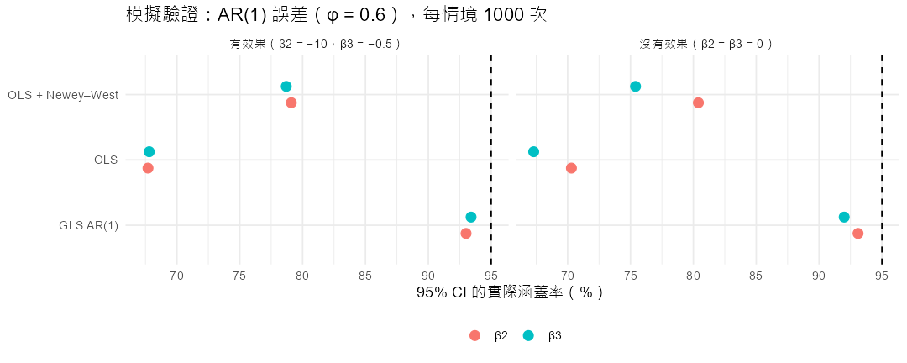

# its-intervention 驗收紀錄

> 2026-11-18｜腳本：`tests/validate.R`｜原始結果：`tests/results/`（`validation_log.csv`、`simulation.csv`、`coverage.png`）
> 環境：R 4.4.3、nlme 3.1-167、sandwich 3.1-1、lmtest 0.9-40、ggplot2 4.0.2；執行約 2 分鐘

**結果：21 項全部通過**（模擬 5、錯誤案例 8、邊界案例 7、一致性 1）。
第一次用 300 次模擬時有 1 項沒通過，見下方「過程紀錄」。

---

## A. 模擬：已知真值

**設定**：月資料，介入前 60 點、介入後 36 點；真實模型 $y = 100 + 0.2T + \beta_2 X + \beta_3 T_{post} + 8\sin(2\pi m/12) + \varepsilon$，誤差為 AR(1)、φ = 0.6、邊際 SD = 5。每個情境 1000 次。

| 情境 | 方法 | 參數 | 偏誤 | 95% CI 涵蓋率 | 拒絕 H0 比例 |
|---|---|---|---|---|---|
| 有效果（β2 = −10，β3 = −0.5） | **GLS AR(1)** | β2 | −0.064 | **93.0%** | 82.8%（檢定力） |
| | | β3 | 0.005 | **93.4%** | 82.1%（檢定力） |
| | OLS | β2 | −0.051 | 67.7% | 93.2% |
| | | β3 | 0.003 | 67.8% | 97.2% |
| | OLS + Newey–West | β2 | −0.051 | 79.1% | 87.0% |
| | | β3 | 0.003 | 78.7% | 93.8% |
| 沒有效果（β2 = β3 = 0） | **GLS AR(1)** | β2 | 0.016 | **93.1%** | **6.9%**（型一錯誤） |
| | | β3 | −0.002 | **92.0%** | **8.0%**（型一錯誤） |
| | OLS | β2 | 0.052 | 70.3% | 29.7% |
| | | β3 | −0.001 | 67.3% | 32.7% |
| | OLS + Newey–West | β2 | 0.052 | 80.4% | 19.6% |
| | | β3 | −0.001 | 75.4% | 24.6% |

**解讀**

1. **三種方法的點估計都幾乎不偏**：自相關不會讓係數偏掉，問題出在標準誤。
2. **OLS 的 95% CI 只涵蓋約 68%**；沒有效果時有 30% 的機率誤判「有效果」，是名目 5% 的 6 倍。這就是 skill 一定要做自相關診斷的原因。
3. **Newey–West 有改善但不夠**（約 79%），在介入後 36 點的樣本下仍然太樂觀。這支持「NW 只當敏感度分析」的設計。
4. **GLS AR(1) 最接近名目水準**，但**仍略為寬鬆**：涵蓋率 92–93%，型一錯誤 7–8%。原因是小樣本下 AR 係數 φ 的估計有偏誤，標準誤會稍微低估。
   → 報告的限制段要寫：「GLS 的 95% CI 在小樣本下可能略窄，p 值在 .05 附近的結果要保守解讀。」

**AR 階數選擇**（60 次，真值 p = 1）：AIC 選 p = 1 有 39 次（65%）、p = 2 有 12 次、p = 3 有 9 次。AIC 偶爾會選太複雜的模型，所以 skill 的規則是「AIC 差距 < 2 時可以選較簡單的模型」。

## B. 錯誤案例：應該停止

| 案例 | 結果 |
|---|---|
| 介入點早於序列 | ✅ 停止：介入時間不在序列範圍內 |
| 介入點晚於序列 | ✅ 停止：介入時間不在序列範圍內 |
| 時間重複 | ✅ 停止：時間重複（同時偵測到間隔不等） |
| 間隔不等（刪掉一個月） | ✅ 停止：1 處不連續 |
| 結果變數有缺值 | ✅ 停止：不自動插補 |
| 介入後只有 2 點 | ✅ 停止：少於 3 點無法估計斜率 |
| 未確認就配適（`approved = FALSE`） | ✅ 報錯拒絕 |
| 年資料要求季節項 | ✅ 報錯 |

## C. 邊界案例：警告但可以繼續

| 案例 | 結果 |
|---|---|
| 介入後只有 8 點 | ✅ 警告「少於 12 點，檢定力有限」，可以繼續 |
| 資料順序打亂 | ✅ 自動排序並說明，介入點仍正確（第 170 期） |
| 介入時間不在月初（1983-01-15） | ✅ 以下一個觀測（1983-02）當起點並說明 |
| 年資料（Nile，無季節） | ✅ 完成，β2 = −289.1（95% CI −404.5 ~ −173.7） |
| 週資料 + Fourier 季節項 | ✅ 完成 |
| 過渡期 3 期 | ✅ 排除 3 點，介入後剩 20 點 |
| 低計數（平均約 4） | ✅ 警告並建議以 quasi-Poisson 為主 |

## D. 一致性

| 案例 | 結果 |
|---|---|
| skill 的 GLS AR(1) 與手寫的 `nlme::gls()` 比較（Seatbelts） | ✅ β2、β3 完全相同（差 = 0） |

---

## 過程紀錄

- **第一次跑（每情境 300 次）**：「虛無情境的型一錯誤」沒通過，GLS 的 β2 拒絕率 = 10.0%，標準是 < 10%。300 次的蒙地卡羅誤差約 ±1.7 個百分點，估計不夠精確。
- **處理**：判定標準**不變**，把模擬次數提高到 1000 次（誤差約 ±0.8 個百分點）。結果是 6.9% 和 8.0%，通過；但也確認 GLS 確實略為寬鬆，已寫進上方解讀第 4 點。
- **Windows 注意**：多行的 `Rscript -e` 會崩潰（segfault），所以一律寫成 `.R` 檔再執行，已寫進 SKILL.md。

## 尚未驗收

- **在新的 Claude 對話中實際觸發 skill**，走一次完整的互動流程（需要使用者執行）。
- 有自相關、但 AR 結構以外的誤差（例如季節性 AR）。
