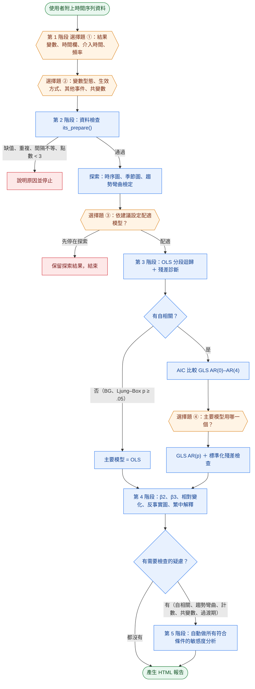

# 決策樹

## 判斷規則（文字版）

| 節點 | 規則 |
|---|---|
| 資料檢查 stop | 時間缺值或重複、間隔不等、Y 有缺值、介入點不在範圍內、任一段 < 3 點 |
| 資料檢查 warn | 任一段 < 12 點；介入前不到一個季節週期；平均計數 < 10 |
| 季節項建議 | 頻率 1 → none；4、12 → dummy；7、52 → fourier（K = 2） |
| 模型家族建議 | 計數且平均 < 10 → quasi-Poisson 為主；其他 → gaussian |
| 有自相關 | OLS 殘差的 Breusch–Godfrey 或 Ljung–Box 任一 p < α（DW 只當參考） |
| AR 階數 | ML 估計比較 AIC，取最小；差距 < 2 時可以選較簡單的模型，但要說明 |
| 趨勢彎曲 | 介入前二次項 p < .10 → 自動做「前段視窗」敏感度分析 |
| Newey–West | 只當敏感度分析；SE 比 OLS 小時加警告 |

## 範圍外：說明理由後停止

- 介入時間未知 → 斷點偵測（`strucchange`）
- 多個介入點、有控制序列、多個單位的面板資料 → 第一版不支援
- 想預測未來 → 預測模型
