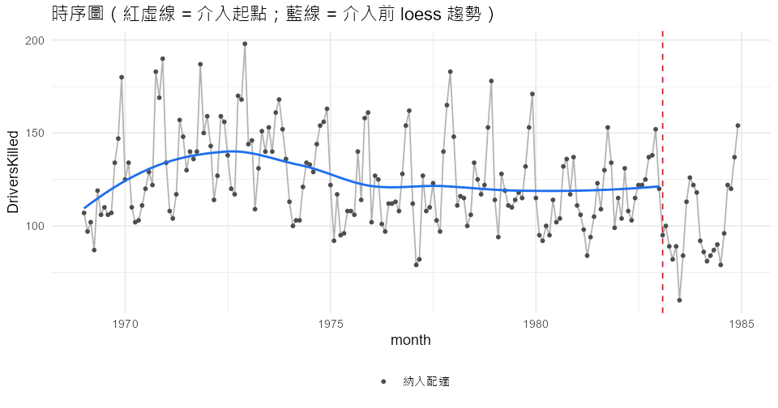

```{r}
#| label: setup
source("../scripts/its.R", encoding = "UTF-8")
its_configure()
sb <- read.csv("../assets/seatbelts.csv")
prep <- its_prepare(sb, "month", "DriversKilled", "1983-02", 12,
                    covariates = c("kms", "PetrolPrice"))
ex <- its_explore(prep, out_dir = "figures")                       # 季節性、趨勢彎曲檢定
sp <- its_spec(prep, "dummy")
m2 <- its_fit(prep, sp, "ols", approved = TRUE)                    # OLS ＋ 月份
dg2 <- its_diagnose(m2, prep, out_dir = "figures", tag = "ols")
ar <- its_select_ar(prep, sp)
m3 <- its_fit(prep, sp, "gls", ar$best_p, approved = TRUE)         # 主要模型 GLS AR(p)
e3 <- its_effects(m3, prep)
f2 <- function(x, d = 1) formatC(x, format = "f", digits = d)
```

# 01｜要解決什麼問題

政策上路、法規生效、新療程開始、建設完工之後，我們常想知道：**這件事發生後，數值有沒有改變？** 例如「安全帶法上路後，駕駛死亡人數有沒有下降？」「健保給付新制實施後，處方量的趨勢有沒有改變？」

最直覺的做法是「比較介入前後的平均」，但在時間序列上這樣做常常會錯：

| 陷阱 | 說明 |
|---|---|
| **原本就有的趨勢** | 序列本來就在下降，介入後平均自然比較低，但這不是介入的效果 |
| **季節性** | 前後兩段涵蓋的月份不同，平均數就會不一樣 |
| **均值回歸** | 政策常在數值異常高時推出，之後的回落本來就會發生 |

**中斷時間序列（Interrupted Time Series, ITS）**的想法是：用介入**前**的趨勢推估「如果沒有介入會怎樣」，也就是**反事實（counterfactual）**，再拿介入後的實際值跟它比較。ITS 是準實驗設計；在無法隨機分派時（例如全國性政策），它是評估介入效果最有力的設計之一。

所以，**拿到下面這樣的資料，就可以用這個 skill**：

- **一條時間序列**：依時間排序、間隔相等（年、季、月、週、日）
- **一個已知的介入時間點**：例如政策上路、法規生效的日期
- **想回答的問題**：介入之後，數值的**水準**有沒有跳動？**趨勢**有沒有改變？

# 02｜核心模型：分段迴歸

$$
Y_t = \beta_0 + \beta_1 T_t + \beta_2 X_t + \beta_3 (T_t - T_0) X_t + \text{季節項} + \varepsilon_t
$$

| 符號 | 意義 | | 係數 | 解釋 |
|---|---|---|---|---|
| $T_t$ | 時間（1, 2, 3, …） | | $\beta_1$ | 介入**前**的斜率 |
| $T_0$ | 介入開始的時間點 | | $\beta_2$ | **水準變化**：介入當下跳了多少 |
| $X_t$ | 介入前 = 0，介入後 = 1 | | $\beta_3$ | **斜率變化**：介入後斜率 = $\beta_1 + \beta_3$ |
| $(T_t - T_0)X_t$ | 介入後經過的時間 | | $\beta_2 + \beta_3 k$ | 介入後第 $k$ 期的效果 |
| 季節項 | 月資料用月份虛擬變數（季資料用季別）；年資料不加 | | | 避免前後兩段涵蓋的月份不同而扭曲效果 |

```{r}
#| label: fig-concept
#| fig-width: 7.5
#| fig-height: 3.4
#| fig-cap: "分段迴歸的概念：灰點為觀測值，藍線為配適，紅虛線為反事實；β1 是介入前的斜率，β2 是介入點的垂直跳動，β3 是斜率的改變。"
set.seed(3)
cd <- data.frame(T = 1:40)
cd$X <- as.integer(cd$T >= 21); cd$Tp <- pmax(cd$T - 21, 0)
cd$mu <- 50 + 0.6 * cd$T - 12 * cd$X - 0.5 * cd$Tp
cd$y <- cd$mu + rnorm(40, 0, 1.6)
cd$cf <- ifelse(cd$X == 1, 50 + 0.6 * cd$T, NA)
ggplot(cd, aes(T)) +
  geom_point(aes(y = y), colour = "grey55", size = 1.3) +
  geom_line(aes(y = ifelse(X == 0, mu, NA)), colour = "#1f6feb", linewidth = 0.9, na.rm = TRUE) +
  geom_line(aes(y = ifelse(X == 1, mu, NA)), colour = "#1f6feb", linewidth = 0.9, na.rm = TRUE) +
  geom_line(aes(y = cf), colour = "#d1242f", linetype = "dashed", linewidth = 0.8, na.rm = TRUE) +
  geom_vline(xintercept = 20.5, linetype = "dotted") +
  annotate("segment", x = 21, xend = 21, y = 50 + 0.6 * 21, yend = 50 + 0.6 * 21 - 12,
           arrow = arrow(length = unit(0.15, "cm")), colour = "#8250df") +
  annotate("text", x = 6, y = 60, label = "β1 介入前斜率", hjust = 0, colour = "#1f6feb") +
  annotate("text", x = 22, y = 56, label = "β2 水準變化", hjust = 0, colour = "#8250df") +
  annotate("text", x = 31, y = 48, label = "β3 斜率變化", hjust = 0, colour = "#1f6feb") +
  annotate("text", x = 32, y = 72, label = "反事實", colour = "#d1242f") +
  labs(x = "時間 T", y = "Y") + theme_minimal()
```

::: {.callout-warning}
## 參數化陷阱
有些文獻把交互作用寫成 $\beta_3 T_t X_t$（沒有減 $T_0$），這時 $\beta_2$ 變成「外推到 $T = 0$ 的水準差」，**不是**介入當下的跳動。本 skill 一律用 $(T_t - T_0)X_t$，讓 $\beta_2$ 可以直接解釋。
:::

# 03｜基本假設

| 假設 | 內容 | 怎麼處理 |
|---|---|---|
| **趨勢延續** | 沒有介入的話，介入前趨勢會持續下去 | 無法直接檢定；看介入前趨勢是否接近線性，做「前段視窗」敏感度分析（只用較近的介入前資料重新估計） |
| **沒有同時事件** | 介入點附近沒有其他會影響結果的事件 | 一定要問使用者；可加共變數 |
| **介入時間明確** | $T_0$ 清楚，或已知過渡期 | 追問；過渡期當敏感度分析 |
| **測量一致** | 介入前後定義、測量方式不變 | 追問 |
| **資料點足夠** | 經驗法則：前後各至少 12 點（Wagner et al., 2002） | 少於 12 點警告，少於 3 點停止 |
| **誤差獨立** | 時間序列**通常不成立** | 一定做殘差診斷；有自相關改用 GLS（見 05 節示範） |

# 04｜完整分析流程

```{mermaid}
%%| fig-width: 7
flowchart TD
  A(["使用者附上時間序列資料"]) --> Q1{{"第 1 階段 選擇題 ①：結果變數、時間欄、介入時間、頻率"}}
  Q1 --> Q2{{"選擇題 ②：變數型態、生效方式、其他事件、共變數"}}
  Q2 --> C["第 2 階段：資料檢查 its_prepare()"]
  C -->|"缺值、重複、間隔不等、點數 < 3"| X1["說明原因並停止"]
  C -->|"通過"| D["探索：時序圖、季節圖、趨勢彎曲檢定"]
  D --> Q3{{"選擇題 ③：依建議設定配適模型？"}}
  Q3 -->|"先停在探索"| X2["保留探索結果，結束"]
  Q3 -->|"配適"| F["第 3 階段：OLS 分段迴歸 ＋ 殘差診斷"]
  F --> G{"有自相關？"}
  G -->|"否（BG、Ljung–Box p ≥ .05）"| H["主要模型 = OLS"]
  G -->|"是"| I["AIC 比較 GLS AR(0)–AR(4)"]
  I --> Q4{{"選擇題 ④：主要模型用哪一個？"}}
  Q4 --> K["GLS AR(p) ＋ 標準化殘差檢查"]
  H --> L["第 4 階段：β2、β3、相對變化、反事實圖、繁中解釋"]
  K --> L
  L --> S{"有需要檢查的疑慮？"}
  S -->|"有（自相關、趨勢彎曲、計數、共變數、過渡期）"| N["第 5 階段：自動做所有符合條件的敏感度分析"]
  S -->|"都沒有"| O(["產生 HTML 報告"])
  N --> O
  classDef ask fill:#fff4e5,stroke:#d97706,color:#7c2d12
  classDef stop fill:#fde8e8,stroke:#d1242f,color:#7f1d1d
  classDef calc fill:#e8f1fe,stroke:#1f6feb,color:#0b3d91
  classDef io fill:#e9f7ef,stroke:#1a7f37,color:#0f5323
  class Q1,Q2,Q3,Q4 ask
  class X1,X2 stop
  class C,D,F,I,K,H,L,N,G,S calc
  class A,O io
```

圖例：🟧 橘色六角形＝停下來問使用者的選擇題（共 4 次，敏感度分析不問、自動做）｜🟦 藍色＝R 函數計算｜🟥 紅色＝停止點｜🟩 綠色＝開始與結束。

**skill 的核心規則**（寫在 `SKILL.md`，每次分析都照同一套走）

| # | 規則 | 為什麼 |
|-|--------------|----------|
| 1 | 要使用者決定的事**一律用選擇題**，選項從資料產生，建議的放第一個 | 使用者不一定會回答開放式問題；介入時間**不由 AI 自己猜** |
| 2 | 資料有缺值、時間重複、間隔不等、任一段少於 3 點 → **停止** | 不自動插補或刪資料，避免分析建立在錯的資料上 |
| 3 | 頻率 > 1 時**預設加季節項** | 不處理季節，效果會被扭曲（Seatbelts 會高估將近一倍） |
| 4 | **一定要診斷殘差自相關**；有自相關就用 AIC 選 GLS AR(p)，請使用者確認 | 自相關會讓 OLS 的標準誤偏小、p 值太小 |
| 5 | 敏感度分析**依條件自動做**；OLS 和只修正標準誤的方法（Newey–West）**只當對照** | 檢查結論換個設定還站不站得住 |
| 6 | 所有數字都來自 `scripts/its.R` 的函數，報告可完整重現 | 不心算、不臨時補算 |

# 05｜實作示範：安全帶法

## 分析請求

> 「這是英國 1969–1984 年每月的駕駛死亡人數，1983 年 1 月 31 日開始強制前座繫安全帶。法律有沒有效？」

skill 依序確認：結果變數 `DriversKilled`、介入起點 1983-02（第一個完整月）、月資料、計數但平均約 120（線性模型可用）、立即生效、同期有石油危機與交通量、油價變動。

## 資料探索



## 模型怎麼選

- **季節性**：介入前資料的季節性 F 檢定 `r .fp(ex$p_season)`，冬季明顯較多 → 加月份虛擬變數（規則 3）。
- **自相關**：OLS ＋ 月份的殘差 lag 1 自相關 = `r f2(dg2$acf_lag1, 2)`，Breusch–Godfrey 檢定 `r .fp(dg2$tests$p_value[grepl("Breusch", dg2$tests$test)])` → 不能只看 OLS（規則 4）。
- **AR 階數**：比較 GLS AR(0)–AR(4)，AIC 最小的是 AR(`r ar$best_p`) → 主要模型 = GLS AR(`r ar$best_p`) ＋ 月份。改用 GLS 後，β2 的標準誤從 `r f2(summary(m2)$coefficients["X", 2])` 變成 `r f2(e3$table$se[2])`。

## 主要結果

```{r}
#| label: fig-main
#| fig-width: 8.5
#| fig-height: 4.3
#| fig-cap: "GLS AR(1) ＋ 月份：藍線為配適值，紅虛線為反事實（沒有安全帶法時的預期）"
its_plot(m3, prep, y_label = "每月駕駛死亡數")$plot
```

```{r}
#| label: tbl-main
tab <- rbind(e3$table[1:4, ], e3$relative)
tab$quantity <- c("介入前斜率（每月）", "**水準變化 β2**", "斜率變化 β3（每月）", "介入後斜率（每月）", "**介入後期間的平均相對變化**")
knitr::kable(tab[, -6], digits = 3, col.names = c("估計量", "估計值", "SE", "95% 下界", "95% 上界"))
```

```{r}
#| label: main-text
#| results: asis
cat(its_explain(e3, prep, "每月駕駛死亡數", " 人"))
```

## 敏感度分析

主要模型是在一組假設下估出來的。敏感度分析每次**只改一個設定**重新估計，看 β2、β3 會不會跟著變：

| 模型 | 怎麼做 | 檢查什麼疑慮 | 結果怎麼看 |
|---|---|---|---|
| **主要模型** GLS AR(1) ＋ 月份 | 基準 | — | 其他列都跟它比 |
| **OLS（未處理自相關）** | 同樣的分段迴歸，但假設相鄰月份的誤差互相獨立 | 忽略自相關會怎樣 | 係數接近，但 CI 偏窄、容易誤判顯著，**只當對照** |
| **OLS ＋ Newey–West** | OLS 的係數，改用 Newey–West 修正標準誤 | 另一種處理自相關的做法 | 小樣本下標準誤仍偏小，**只當對照** |
| **＋ 共變數**（kms、PetrolPrice） | 模型加入每月行駛里程和油價 | **同時事件**：死亡下降會不會只是因為大家少開車、油價變貴 | 加入後 β2 仍為負且大小相近 → 下降不完全是交通量、油價造成的 |
| **排除介入後前 2 期** | 1983-02、1983-03 不拿來估計 | **介入時間**：法律可能要一段時間才完全生效，頭幾個月可能異常 | β2 沒有變小 → 效果不是只靠頭兩個月撐起來的 |
| **只用介入前最近 96 期** | 只用 1975-02 之後的介入前資料估趨勢 | **趨勢延續**：1973–74 石油危機讓介入前趨勢彎曲，直線外推的反事實可能不準 | β2 跟主要模型差不多或更明確 → 結論不是被早期那段彎曲帶出來的 |
| **quasi-Poisson** | 把死亡數當計數資料，用率比表示效果，並允許變異比平均大 | **模型形式**：把計數當連續數值處理是否恰當 | 率比 < 1 表示下降；它的標準誤也用 Newey–West，CI 可能偏窄 |

```{r}
#| label: fig-sens-b2
#| fig-width: 8.5
#| fig-height: 3.4
#| fig-cap: "敏感度分析：β2 水準變化（點 = 估計值，橫線 = 95% CI，虛線 = 0）"
sens <- its_sensitivity(m3, prep, covariates = c("kms", "PetrolPrice"),
                        transition = 2, pre_window = 96, data = sb)
ss <- sens[!is.na(sens$b2) & sens$scale == "原尺度（差值）", ]
ss$model <- factor(ss$model, levels = rev(ss$model))
forest <- function(est, lo, hi, xlab)
  ggplot(ss, aes({{ est }}, model)) +
    geom_vline(xintercept = 0, linetype = "dashed", colour = "grey50") +
    geom_errorbarh(aes(xmin = {{ lo }}, xmax = {{ hi }}), height = 0.25, colour = "#1f6feb") +
    geom_point(size = 2.4, colour = "#1f6feb") +
    labs(x = xlab, y = NULL) + theme_minimal()
forest(b2, b2_lower, b2_upper, "β2 水準變化（人，95% CI）")
```

```{r}
#| label: fig-sens-b3
#| fig-width: 8.5
#| fig-height: 3.4
#| fig-cap: "敏感度分析：β3 斜率變化（點 = 估計值，橫線 = 95% CI，虛線 = 0）"
forest(b3, b3_lower, b3_upper, "β3 斜率變化（人／月，95% CI）")
```

```{r}
#| label: tbl-sens
role <- ifelse(grepl("^主要模型：", sens$model), "主要模型",
        ifelse(grepl("quasi-Poisson", sens$model), "把死亡數當計數資料（率比；CI 可能偏窄）",
        ifelse(grepl("Newey|^OLS", sens$model), "只當對照",
        ifelse(grepl("共變數", sens$model), "下降是不是因為少開車、油價變動？",
        ifelse(grepl("排除", sens$model), "法律是不是要一段時間才生效？",
        ifelse(grepl("只用介入前", sens$model), "避開石油危機，反事實會不會不同？",
        ""))))))
ok <- !is.na(sens$b2)
rr <- grepl("率比", sens$scale)
fmt <- function(e, l, u, d) ifelse(rr, sprintf("率比 %.3f（%.3f ~ %.3f）", e, l, u),
                                       sprintf(paste0("%.", d, "f（%.", d, "f ~ %.", d, "f）"), e, l, u))
null <- ifelse(rr, 1, 0)
star <- function(l, u) ifelse(u < null | l > null, " ✱", "")
knitr::kable(data.frame(
  模型 = sens$model, 檢查什麼 = role,
  `β2 水準變化（95% CI）` = paste0(fmt(sens$b2, sens$b2_lower, sens$b2_upper, 1), star(sens$b2_lower, sens$b2_upper)),
  `β3 斜率變化（95% CI）` = paste0(fmt(sens$b3, sens$b3_lower, sens$b3_upper, 2), star(sens$b3_lower, sens$b3_upper)),
  check.names = FALSE)[ok, ], row.names = FALSE, align = "llcc")
# 不列入判斷的對照模型：OLS、Newey–West（quasi-Poisson 的 CI 也用 Newey–West）
judge <- ok & !rr & !grepl("Newey|^OLS", sens$model)
n_j <- sum(judge)
b2_sig <- sum(sens$b2_upper[judge] < 0 | sens$b2_lower[judge] > 0)
b3_sig <- sum(sens$b3_upper[judge] < 0 | sens$b3_lower[judge] > 0)
```

✱ = 95% CI 不含 0（率比則為不含 1）。

- **β2 水準變化**：所有模型都是下降。撇開只當對照的 OLS 和 Newey–West，`r n_j` 個模型中有 `r b2_sig` 個顯著 →「介入當下的跳動是否顯著」取決於設定，不穩健。
- **β3 斜率變化**：`r n_j` 個模型中有 `r b3_sig` 個顯著，點估計都接近 0 →`r if (b3_sig == 0) "在所有設定下都**沒有證據顯示趨勢改變**。" else "趨勢改變的證據取決於設定。"`介入後只有 23 個月，斜率本來就不容易估準。

**結論**：安全帶法上路後，每月駕駛死亡數**方向一致地下降**（約 16–26 人，或約 19%）；但在把自相關納入考量的主要模型中，水準變化的 95% CI 剛好包含 0。趨勢則在所有設定下都沒有證據顯示改變。比較精確的說法是「資料支持法律降低了駕駛死亡，但單看介入當下的跳動，統計上仍有不確定性」，而不是簡單的「有效／無效」。這正是 skill 要求同時呈現 CI 和敏感度分析的原因。

# 06｜限制與貢獻

**限制**

- ITS 的因果解釋建立在「趨勢延續」和「沒有同時事件」兩個無法直接檢定的假設上；skill 只能追問、做敏感度分析，不能保證假設成立。
- 第一版只支援單一序列、單一介入點；**不支援**控制序列、多個介入點、面板資料。
- GLS 在小樣本下略為寬鬆（模擬涵蓋率約 92–93%，見 skill 內的 `VALIDATION.md`）。
- 計數資料的 quasi-Poisson 只用 Newey–West 處理自相關，小樣本同樣不可靠。

**貢獻**

- 把「季節性一定要處理」「自相關一定要診斷」「不能只靠修正標準誤（Newey–West）就下結論」這些**容易被跳過的判斷**，寫成固定規則和停止點（見 04 節的核心規則）。
- 用模擬**量化**了跳過這些步驟的代價：OLS 誤判率約 30%（見 `VALIDATION.md`）。
- 所有數字由經過驗收的函數產生（21 項驗收全部通過，見 `VALIDATION.md`），報告可以從保存的狀態完整重現。

**未來方向**：比較組 ITS（加控制序列）、ARIMA 介入模型、多介入點、斷點偵測的前處理。

# 參考資料

- Bernal, J. L., Cummins, S., & Gasparrini, A. (2017). Interrupted time series regression for the evaluation of public health interventions: a tutorial. *International Journal of Epidemiology, 46*(1), 348–355.
- Harvey, A. C., & Durbin, J. (1986). The effects of seat belt legislation on British road casualties: A case study in structural time series modelling. *Journal of the Royal Statistical Society, Series A, 149*(3), 187–227.
- Hyndman, R. J., & Athanasopoulos, G. (2021). *Forecasting: Principles and Practice* (3rd ed.). OTexts.
- Wagner, A. K., Soumerai, S. B., Zhang, F., & Ross-Degnan, D. (2002). Segmented regression analysis of interrupted time series studies in medication use research. *Journal of Clinical Pharmacy and Therapeutics, 27*(4), 299–309.
- R 套件：`nlme`、`sandwich`、`lmtest`、`ggplot2`；資料：R 內建 `Seatbelts`。

# 附錄 A｜在 Claude 上使用這個 skill

skill 安裝在 `~/.claude/skills/its-intervention/`。在 Claude Code 中提到「介入分析」「中斷時間序列」「政策實施後有沒有效」並附上資料，就會觸發。

```
its-intervention/
├── SKILL.md                 流程與停止點
├── scripts/its.R            所有計算函數
├── scripts/finalize_report.R 產生報告
├── references/              方法說明、決策樹
├── assets/report.qmd        報告模板；seatbelts.csv
├── tests/validate.R         驗收腳本
└── VALIDATION.md            驗收紀錄
```

**對話示意**

> **使用者**：幫我看安全帶法有沒有效 `seatbelts.csv`
>
> **Claude**：我已讀取 seatbelts.csv：192 筆、9 個欄位，時間從 1969-01 到 1984-12，看起來是月資料。請先回答 4 題選擇題：
>
> 【結果變數】要分析哪一欄的變化？ ● `DriversKilled`（建議） ○ `front` ○ `rear` ○ `VanKilled` ○ 其他
>
> 【介入時間】介入從哪一期開始？ ● 1983-02（建議：法律 1/31 生效後第一個完整月） ○ 1983-01 ○ 其他
>
> ……（另外 6 題、資料檢查、探索圖、建議設定）……
>
> **Claude**：OLS 殘差有自相關（Breusch–Godfrey p < 0.0001）。主要模型要用哪一個？ ● GLS AR(1)（建議，AIC 最小） ○ GLS AR(2) ○ 仍用 OLS（不建議：SE 會被低估） ○ 其他

# 附錄 B｜可重現性

- 所有分析由 `scripts/its.R` 的函數產生；報告依保存的分析狀態（`state.rds`）重新執行。
- 報告記錄資料 MD5、R 與套件版本、每個確認點的使用者回答。
- 驗收：`Rscript tests/validate.R`（約 2 分鐘），結果寫入 `tests/results/`。

```{r}
#| label: session
#| echo: true
#| code-fold: true
sessionInfo()$R.version$version.string
sapply(c("nlme", "sandwich", "lmtest", "ggplot2"), function(p) as.character(packageVersion(p)))
```

# 附錄 C｜數學細節

**GLS AR(p)**：$\varepsilon_t = \phi_1\varepsilon_{t-1} + \dots + \phi_p\varepsilon_{t-p} + u_t$，$u_t \sim N(0, \sigma^2)$。誤差的共變異矩陣 $\Sigma(\phi)$ 由 AR 結構決定，$\hat\beta = (X^\top\Sigma^{-1}X)^{-1}X^\top\Sigma^{-1}y$。AR 階數用 ML 估計比較 AIC，最終模型用 REML。

**介入後第 k 期效果**：$\hat\beta_2 + k\hat\beta_3$，變異數 $c^\top \hat V c$，其中 $c$ 在 $X$、$T_{post}$ 位置分別為 1、$k$。

**整體相對變化（delta method）**：$R = \dfrac{a^\top\beta}{b^\top\beta}$，$a$ 為介入後各期效果的加總向量，$b$ 為介入後各期反事實的加總向量；$\nabla R = \dfrac{a}{b^\top\beta} - \dfrac{(a^\top\beta)\,b}{(b^\top\beta)^2}$，$\text{SE}(R) = \sqrt{\nabla R^\top \hat V \nabla R}$。

**Newey–West**：落後期 $L = \lfloor 4(n/100)^{2/9} \rfloor$，Bartlett 權重，不做 prewhitening。
